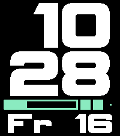

# AntiGrav

[AntiGrav mini on the Pebble Appstore](https://apps.repebble.com/antigrav-mini_82b16c3b6e1347849781f5be)

[AntiGrav mini on the Rebble App Store](https://apps.rebble.io/en_US/application/6ae5cd8ebb43f2000989631e)

## Description

AntiGrav mini is a digital watchface built for quick glances, with big, large stacked hours and minutes, a flexible slots row, and the date below. 
This is an alternative version of AntiGrav in which the clock digits are smaller, to make room for a larger date, a larger bar, and a sidebar dedicated to status icons.

Customization
- Basic and advanced color customization
- Three fonts to choose from
- Configurable date formats
- Configurable slots: status icons, watch battery, phone battery, step goal, seconds, seconds bar, a split bar with two readings, or empty
- Leading zeros
- Language for day and month abbreviations (EN / ES / FR / PT / DE / IT / NL / SV / DA / NB / ID / TL)

Status icons for
- Bluetooth disconnected
- Quiet Time active
- Low watch battery (with configurable threshold)
- Watch battery charging
- Watch battery fully charged
- Low phone battery
- Phone battery charging
- Daily steps goal reached

Seconds
- Configurable to be:
    - always on
    - hidden during Quiet Time
    - revealed with a wrist flick
    - off
- Configurable flick count and reveal duration, to avoid accidental activation and save battery
- The seconds bar follows the same rules

- And it's completely free and open source!

## License

[MIT](LICENSE)

